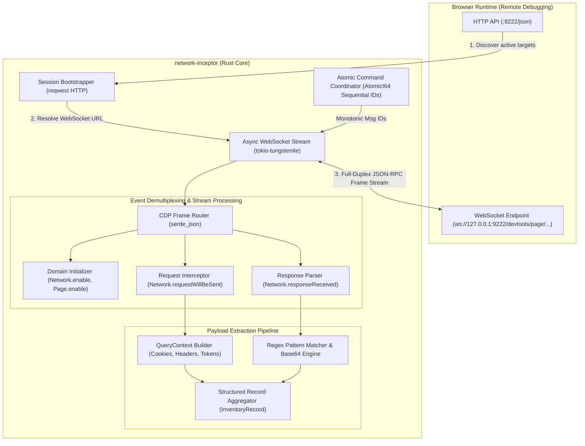

# network-inceptor

[](https://www.rust-lang.org/)
[](https://tokio.rs/)
[](https://chromedevtools.github.io/devtools-protocol/)

High-performance, asynchronous network telemetry and traffic interception engine written in Rust. Connects directly to the Chrome DevTools Protocol (CDP) WebSocket interface to capture, filter, decode, and extract live HTTP network payloads at wire speed.

---

## Architecture & Systems Overview

`network-inceptor` uses an asynchronous event loop powered by Tokio. It bootstraps an active browser session over HTTP, upgrades to a duplex WebSocket connection, activates CDP telemetry domains, and demultiplexes incoming event streams in real time.



---

## Detailed Systems Pipeline

### 1. Dynamic Session Discovery & Handshake
- **Target Resolution**: Queries `http://127.0.0.1:9222/json` to discover live page targets and extracts the canonical `webSocketDebuggerUrl`.
- **WebSocket Upgrade**: Establishes a persistent full-duplex WebSocket connection using `tokio-tungstenite` with asynchronous ping/pong keepalive management.

### 2. Monotonic Command Sequencing & Domain Activation
- **Lock-Free Concurrency**: Uses `std::sync::atomic::AtomicI64` with `Ordering::SeqCst` to coordinate monotonically increasing command IDs across concurrent async tasks without mutex lock contention.
- **Domain Subscription**: Sends JSON-RPC commands activating low-level browser telemetry domains:
  - `Network.enable`: Streams all wire-level HTTP/HTTPS traffic.
  - `Page.enable`: Streams document lifecycle events.

### 3. Stream Demultiplexing & Zero-Copy Extraction
- **Frame Ingestion**: Consumes raw `tungstenite::protocol::Message::Text` frames asynchronously via `futures_util::StreamExt`.
- **Event Filtering**: Matches methods (`Network.requestWillBeSent`, `Network.responseReceived`) using zero-allocation field checks in `serde_json::Value`.
- **State Assembly**: Assembles session context (`QueryContext`), tracking dynamic cookies, authorization headers, CSRF form tokens, and decoded payloads via `base64::Engine`.

---

## Technical Stack

| Component | Technology | Rationale |
| :--- | :--- | :--- |
| **Language** | Rust (2021 Edition) | Predictable sub-millisecond execution, zero-cost abstractions, memory safety. |
| **Async Runtime** | `tokio 1.x` (`full`) | Multi-threaded async worker pool, timers, non-blocking I/O primitives. |
| **WebSocket** | `tokio-tungstenite 0.24` | Raw asynchronous frame processing with minimal protocol overhead. |
| **JSON Handling** | `serde_json 1.0` | Flexible parsing of arbitrary dynamic JSON-RPC protocol messages. |
| **Pattern Matching** | `regex 1.x` | Compiled regular expressions for deep packet and token inspection. |
| **Logging** | `tracing` & `tracing-subscriber` | Structured operational diagnostics with low overhead. |

---

## Build & Execution

### 1. Launch Browser with CDP Enabled
```bash
# Windows
launch_edge.bat
# or launch Chrome/Edge manually
msedge.exe --remote-debugging-port=9222 --user-data-dir="C:/tmp/edge_cdp_profile"
```

### 2. Compile & Run
```bash
# Build optimized release binary
cargo build --release

# Execute interception engine
cargo run --release
```

---

## Author
**Hemal Shah**  
Systems & AI Platform Engineer  
[https://tensix.in](https://tensix.in) | [github.com/hemal9102](https://github.com/hemal9102)
